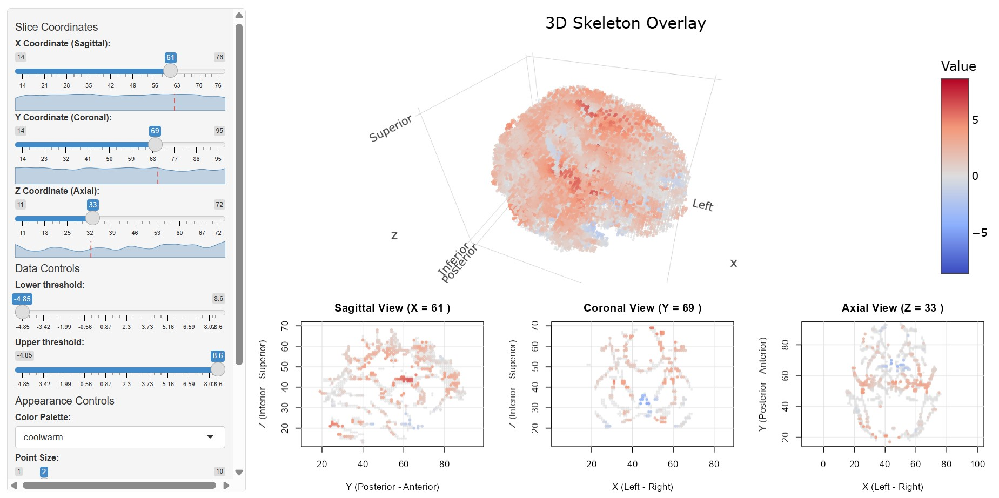
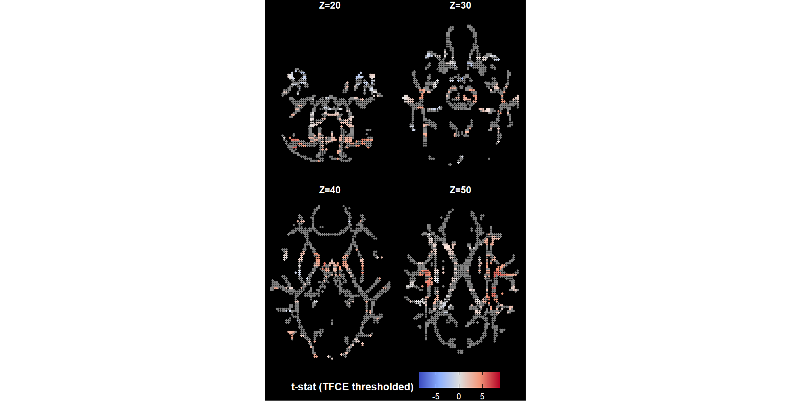

# WMskelstats
### Replaced `rpyANTs` with pre-installed ANTs binaries
- reticulate no longer required.
- ANTs can be downloaded and installed from https://github.com/ANTsX/ANTs/releases . No compiling required.
- ANTs is already installed on NTU HPC (`module load ANTs/2.5.2`)
- Ran the following code successfully. Output files @ `/scratch/junhong.yu/HBN_output`
- In RStudio, ANTs can be loaded by using the full path to its bin/ subdirectory e.g.: `Sys.setenv(PATH = paste("C:/path_to_ants_binaries/ants-2.6.5/bin", Sys.getenv("PATH"), sep=";"))` ("sep=;" for Windows, "sep=:" for Linux). Or only set the relevant coregistration function: `options(WMskelstats.antsApplyTransforms = "C:/path_to_ants_binaries/ants-2.6.5/bin/antsApplyTransforms")`


```
dat=qsi_extract(inputdir="/scratch/junhong.yu/HBN",
              outputdir="/scratch/junhong.yu/HBN_output",
              metrics=c('fa', 'md'),
              skeleton_fathreshold=0.2,
              dti_tensor='dtiTensor',
              dti_L=1,
              nthread=16,
              keep_maps=FALSE,
              silent=FALSE)
```

### To install on NTU HPC (WildFly terminal)
I had to run this on the Wildfly terminal because for some reason `qintel_viz` is not connected to the internet. The above command was ran on `qintel_viz` , after the installation in the Wildfly terminal.


Load modules and open an R session with:
```
module load r/4.6.0
module load gnu/gcc-12.3
module load ANTs/2.5.2
R
```
Note, any version of R<4.5.0 will not work. 

Install `WMskelstats` (development branch) within this R session:
```
remotes::install_github("cogbrainhealthlab/WMskelstats")
```
### To do (03/10/2026)
- need to compare output data with those generated using `rpyANTs` (main branch version of the package). I could not get `rpyANTs` to work on NTU HPC. I suppose they should be identical since we are using the pre-installed ANTs binary instead a custom-made ANTs replacement function.
- previously, input files were not correctly detected when the input dir contains ses-* sub-directories. In this version of `qsi_extract()`, input paths are modified to detect files correctly within ses-* sub-directory, but these paths may not work when there are no ses-* subdirectories.
- update docs: instructions to install ANTs binaries.
- add a `comments` object to the output .rds. This will be useful to document the version of qsiprep/qsirecon used.

## Workflow

WMskelstats provides function to analyse diffusion weighted imaging using diffusion tensor imaging (DTI), diffusion kurtosis imaging (DKI), and Neurite Orientation Dispersion and Density Imaging (NODDI) outputs from [QSIprep](https://qsiprep.readthedocs.io/en/latest/) and [QSIrecon](https://qsirecon.readthedocs.io/en/latest/) pipelines.

WMskelstats's main steps are:

- Users pick a metric (e.g. 'fa', 'md', 'icvf')

- Computing tensors using the [dti package](https://cran.r-project.org/package=dti) from available bval/bvec/dwi data (only for DTI/DKI metrics), or picking existing tensor maps already computed by QSIrecon

- If not already in MNI152 space, coregisters them to MNI 152 using [rpyANTS](https://cran.r-project.org/package=rpyANTs) and the from-ACPC_to-MNI152NLin2009cAsym transform generated by QSIprep

- If applicable, downsamples it to a 2 mm resolution space

- Masks out the metric data with a template fractional anisotropy (FA) skeleton (currently, FMRIB58 2mm)

All of these steps are done on automatically from all subjects from a given QSIprep output directory (or QSIrecon derivatives/[] subdirectory), and the whole cohort metric data is stored in the same skeleton-space within a single cohort-wide R matrix. This R matrix can then be analysed with voxel-wise analyses, including linear models and linear mixed models, with threshold-free cluster enhancement.

## Demonstration

For this demonstration, we use data from the Penn LEAD (Penn Longitudinal Executive functioning in Adolescent Development) public dataset, already preprocessed using QSIPrep, from the [OpenNeuro platform (ds007090, 1.0.4)](https://openneuro.org/datasets/ds007090/versions/1.0.4).

### Extracting skeleton maps

The function qsi_extract() handles the extraction of a cohort-wide skeleton map from the whole dataset as follows:

```{r eval=FALSE, include=TRUE}
metrics_skeletons=qsi_extract(
       inputdir='../ds007090_raw/', #the base openneuro dataset
       outputdir='../ds007090_dti', #user-defined output directory
       metrics=c('fa','md'),  #metrics selected
       skeleton_fathreshold = 0.2, #FA threshold of the template mask
       #Parameters for the dti package, only applicable if metric maps are 
       #not present inside the inputdir already:
       dti_tensor='dtiTensor', #or 'dkiTensor'
       dti_method='linear' 
       dti_sigma=NULL, 
       dti_L=1, 
       #optional path for QSIrecon outputs (if they are not already transformed in
       #MNI152, WMskelstats can reuse the ACPC-to-MNI152 transforms from QSIprep
       #outputs, assuming they are from the same dataset)
       #qsiprep_path='../ds007090_raw/',
       nthread=4, #number of CPU threads to use
       silent=FALSE, #whether to print messaging at all
       keep_maps = FALSE  #whether to save .nii metrics maps in native and MNI space
       ) 
```

Here is a snippet of the extraction process when silent=FALSE:

```{r eval=FALSE, include=TRUE}
Preloading ANTs...

Processing sub-138950_ses-1... 
  Metric: fa 
  => No preexisting map found, trying to build a dti object... 
  => Fetching individual DWI data ... |===============================================================================| 100%
  => Computing diffusion tensor using dtiTensor... 
  outlier: Total CPU cores available: 8 CPU cores in use: 4. 
  5.81966 secs for 317257 voxel 
  sioutlier completed Data transformation completed 2026-09-16 15:46:32 
  Diffusion tensors (linearized model) generated 2026-09-16 15:46:32 
  dti3Dreg: Total CPU cores available: 8 CPU cores in use: 4. 
  2.313678 for 1113020 voxel 
  mcorr: Total CPU cores available: 8 CPU cores in use: 4.
  4.63812 estimated spatial correlations 2026-09-16 15:46:43 
  first order correlation in x-direction 0.106 
  first order correlation in y-direction 0.171 
  first order correlation in z-direction 0.0968 
  thcorr:estimated corresponding bandwidths 2026-09-16 15:46:43 
  dti3Dev: Total CPU cores available: 8 CPU cores in use: 4. 
  0.2796469 for 317257 voxel 
  estimated scale information 2026-09-16 15:46:44 
  dtiind3: entering function 2026-09-16 15:46:44 
  Total CPU cores available: 8 CPU cores in use: 4. 
  dtiind3: calculation took 1.233865 secs for 317257 voxel 
  dtiind3: exiting function 2026-09-16 15:46:45 
=> Coregistering metrics map to MNI152NLin2009cAsym... 
=> Extracting values using the FMRIB58 FA 2mm template skeleton... 

 Metric: md 
 => Reusing previously computed tensor... 
 => Coregistering metrics map to MNI152NLin2009cAsym... 
 => Extracting values using the FMRIB58 FA 2mm template skeleton... 

Processing sub-138950_ses-2... 
```

At the end of the process, two R objects are generated: skel_fa_FMRIB58_skeleton_2mm_t0.2.rds and skel_md_FMRIB58_skeleton_2mm_t0.2.rds, named according to the metrics (here, fa and md), skeleton template (FMRIB58_skeleton_2mm) and FA threshold used (0.2). Each .RDS is a list with the metrics data (N subjects X V voxel values), along with metadata containing the MNI coordinates for the voxels of the skeleton, the skeleton template name and the FA threshold chosen.

### Statistical analyses

For the sake of the demo, we already provide two extracted .rds files. They can be downloaded (\~62 MB total) from the Github directory to a desired destinations using the following function:

```{r}
demodata=dl_demo(path=tempdir(), #R's temporary directory 
                 quiet=TRUE)
```

Here, we run the skeleton data outputted by qsi_extract() for the FA data of the cohort. 

```{r}
dti_data=readRDS(paste0(demodata,"/skel_fa_FMRIB58_skeleton_2mm_t0.2.rds"))
skeleton=dti_data$skel_fa
```

We load the behavioural data to select variables for our models, and select participant with matching IDs and sessions to that of the data matrix's row names:

```{r}
beh_data=read.csv(paste0(demodata,"/ds007090_behdata.csv"))
beh_data=beh_data[order(beh_data$participant_id),]

#We match the row names (e.g., "sub-0001_ses-1"", "sub-0002_ses-2"") in the matrix:
beh_data$id_ses=paste0(beh_data$participant_id, '_', beh_data$session_id)
beh_data=beh_data[which(beh_data$id_ses %in% row.names(skeleton)),]

```

In this example, we test the effect of age on FA, controlling for sex, with a simple linear model with the `LM_TFCE()` function. The function identifies voxel-wise clusters in the white matter skeleton via threshold-free cluster enhancement (TFCE) correction significant at cluster-wise p < .05:

```{r}
model_LM=LM_TFCE(model=beh_data[,c('age_months','sex')], #all model variables
              contrast=beh_data[,'age_months'], #main predictor of interest
              vox_data=skeleton[row.names(skeleton),], 
              coords=dti_data$skel_coords,
              smooth_FWHM=5, #full-width at half-maximum smoothing kernel
              nperm=1000,  #number of permutations
              tail=2,    #two-tailed effect
              nthread=2) #number of CPU threads to use

#cluster-wise threshold           
model_thresh_LM=TFCE_threshold(model_LM, p=0.05,  k=20)
```

The identified clusters and their coordinates are summarised in the model object:


```{r}
print(model_thresh_LM$cluster_level_results)
```

WMskelstats also has a linear mixed models function (`LME_TFCE()`) which is used in a similar way and allows the for addition of a random variable:

```{r}
model_LME=LME_TFCE(model=beh_data[,c('age_months','sex')],
               contrast=beh_data[,'age_months'], 
               random=beh_data[,'participant_id'],
               vox_data=skeleton[row.names(skeleton),], 
               coords=dti_data$skel_coords, 
               smooth_FWHM=5, 
               nperm=1000, 
               tail=2, 
               nthread=2)
#to choose the cluster threshold value:
model_thresh_LME=TFCE_threshold(model_LME, p=0.05,  k=20) 
```
Clusters with the mixed models:

```{r}
print(model_thresh_LME$cluster_level_results)
```
### Plotting

The package provides an interactive viewer window (`skel_viewer()`) which allows viewing the skeleton's slices at each axis (axial, coronal, sagittal), as well as interactively visualising the data in 3D space. Below is an example screenshot with the significant clusters identified previously:

```{r, eval=FALSE}
plot_skel(coords=dti_data$skel_coords,
          data=model_thresh_LME$thresholded_tstat_map)
```



A static 2D plot can also be created with `plot_lightbox()` which lets users define the exact slices they wish to plot, in a grid-like manner:

```{r}
plot_lightbox(z_slices=c(20, 30, 40, 50),
              vox_data=model_thresh_LME$thresholded_tstat_map, 
              coords=dti_data$skel_coords,
              pointsize=1, 
              strip_fontsize=10,
              strip_margin=5,
              cmap="coolwarm", 
              colorscale_title="t-stat (TFCE thresholded)",
              dark_mode=TRUE, #black background instead of white
              nrow=2, #number of rows on the grid
              na_color="#7F7F7F")
```


